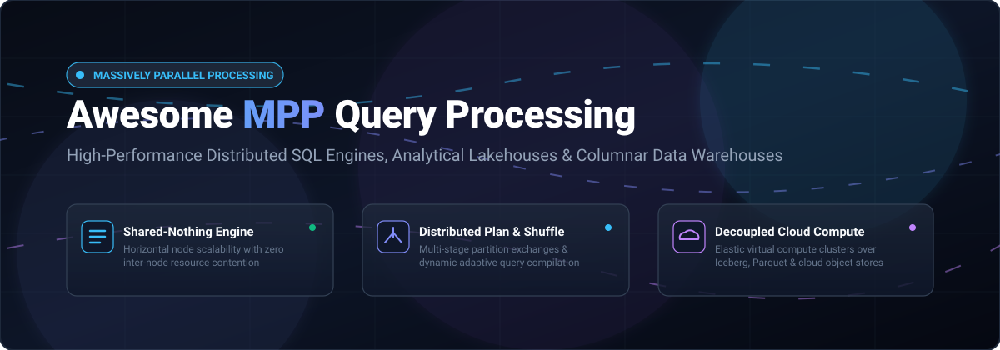

# 🚀 Awesome Massively Parallel Query Processing (MPP)

### A Curated Directory of High-Performance MPP Databases, Distributed SQL Engines, and Modern Cloud Data Warehouses ⚡

  
  
  
  
  
  
  

---

## 📑 Table of Contents

- [🌐 Sector Overview & Market Dynamics](#-sector-overview--market-dynamics)
- [☁️ SaaS & Managed Hosted Platforms](#️-saas--managed-hosted-platforms)
- [🔓 Open-Source GitHub Projects](#-open-source-github-projects)
- [📊 Architectural Comparison Matrix](#-architectural-comparison-matrix)
- [🔍 Key Concepts & Terminology](#-key-concepts--terminology)
- [🤝 How to Contribute](#-how-to-contribute)
- [💖 Support](#-support)
- [📈 Star History](#-star-history)
- [📜 Disclaimer](#-disclaimer)

---

## 🌐 Sector Overview & Market Dynamics

The global **Massively Parallel Processing (MPP) & Cloud Analytical Data Warehouse** market is currently estimated at **$12.5+ billion** and is projected to expand beyond **$36 billion by 2032**, demonstrating an aggressive ~19.5% CAGR driven by exabyte-scale analytics, real-time streaming ingestion, and AI/ML model feature store workloads. 

Market concentration is **moderately high and split between two distinct tiers**: the managed enterprise data warehouse tier is concentrated among dominant hyper-scaler giants (Microsoft Azure, Google Cloud, AWS) and pure-play leader Snowflake (together capturing over 75% of commercial enterprise cloud spend), while the interactive query engine and open-lakehouse tier remains dynamic and fragmented, with high-performance specialized engines (ClickHouse, StarRocks, Apache Doris, and Trino) rapidly securing workload-specific adoption for real-time observability and federated queries.

---

## ☁️ SaaS & Managed Hosted Platforms

Below is a curated breakdown of industry-leading commercial and SaaS Massively Parallel Query Processing platforms, sorted in descending order by **Company Size (Revenue / Market Capitalization / Valuation)**:

| 🏷️ Platform | 🏢 Company & Valuation / Scale | ⚡ Architecture & Highlights | 💳 Specific Starting Price | 🎁 Free Tier / Free Trial Limits |
| :--- | :--- | :--- | :--- | :--- |
| **[Azure Synapse SQL](https://azure.microsoft.com/en-us/products/synapse-analytics)** | **Microsoft** *(~$3.10T Market Cap / ~$245B Ann. Rev)* | Scale-out MPP architecture with 60 fixed distributions, Data Movement Service (DMS) for cross-node reshuffling, and unified hybrid Dedicated & Serverless SQL pools. | **Serverless SQL:** `$5.00` per TB of data processed. **Dedicated SQL:** `$1.20`/hour for entry DW100c tier. | **Permanent Free Tier:** Serverless SQL queries up to `1 TB/month` processed permanently free. Plus **30-day free trial** with `$200` in Azure credits. |
| **[Google BigQuery](https://cloud.google.com/bigquery)** | **Alphabet / Google** *(~$2.15T Market Cap / ~$42B Cloud ARR)* | Serverless MPP with dynamic query execution trees, disaggregated petabit Borg shuffle network, and autonomic query plan adaptation during execution. | **On-demand:** `$6.25` per TB scanned. **Editions Compute:** `$0.04` per slot-hour (Standard Edition). | **Permanent Free Tier:** `10 GB` active storage & `1 TB` query data processed every month forever. Plus **90-day free trial** with `$300` in Google Cloud credits. |
| **[Amazon Redshift](https://aws.amazon.com/redshift/)** | **Amazon / AWS** *(~$2.05T Market Cap / ~$105B AWS ARR)* | Shared-nothing MPP cluster with automated machine-code compilation service, hardware-accelerated AQUA cache, and Redshift Serverless auto-scaling. | **Serverless:** `$0.375` per RPU-hour (Redshift Processing Unit, min 8 RPUs = `$3.00`/hr). **Provisioned:** `$0.25`/hr (dc2.large node). | **60-day free trial:** `750 DC2.large node hours/month` for provisioned clusters. Or **`$300` free trial credits** for Amazon Redshift Serverless valid for 90 days. |
| **[Snowflake MPP Engine](https://www.snowflake.com/)** | **Snowflake Inc.** *(~$55B Market Cap / ~$3.6B Ann. Rev)* | Multi-cluster shared-data architecture decoupling centralized storage from independent MPP virtual compute warehouses with zero concurrency contention. | **Standard Edition:** `$2.00` per Snowflake Credit (XS warehouse consumes 1 credit/hour = `$2.00`/hr of compute). | **30-day free trial:** Includes **`$400` in free usage credits** with pre-loaded benchmark datasets. |
| **[Databricks SQL Serverless](https://www.databricks.com/product/databricks-sql)** | **Databricks** *(~$43B Valuation / ~$2.4B Ann. Rev)* | Photon C++ vectorized MPP engine executing directly against open lakehouses (Delta Lake, Apache Iceberg) with sub-second cluster startup. | **Serverless SQL:** `$0.70` per Databricks Unit (DBU). **Pro SQL:** `$0.22` per DBU (~`$1.40`/hr starting cluster). | **14-day free trial:** Full unrestricted platform access to Databricks SQL Serverless warehouses and lakehouse governance tools. |
| **[OpenText Vertica](https://www.vertica.com/)** | **OpenText** *(~$8.5B Market Cap / ~$5.8B Ann. Rev)* | Columnar shared-nothing MPP data warehouse with down-node query redistribution, projection-based physical storage design, and in-database ML. | **Cloud BYOL:** Starting from `~$0.45`/core-hour. **Annual License:** Commercial subscriptions starting from `$1,500`/node/year. | **Permanent Free Tier:** Vertica Community Edition is **free forever for up to 3 cluster nodes and 1 TB** of data storage. |
| **[Teradata VantageCloud](https://www.teradata.com/products/vantagecloud)** | **Teradata Corporation** *(~$3.8B Market Cap / ~$1.8B Ann. Rev)* | Proven enterprise shared-nothing MPP with Parsing Engines (PE), Access Module Processors (AMPs), BYNET interconnect, and elastic Lake compute clusters. | **VantageCloud Lake:** Starting tier compute at `$4.00` per Vantage Unit (VU) or `~$1.68`/node-hour on AWS/Azure. | **30-day free trial:** Environment trial with **`$300` in free computing credits** and guided hands-on analytical sandboxes. |
| **[Starburst Galaxy](https://www.starburst.io/platform/starburst-galaxy/)** | **Starburst Data** *(~$3.35B Valuation / ~$100M+ ARR)* | Managed distributed MPP query fabric built on Trino; queries disparate object storage lakes (Iceberg, Delta, Hive) and relational stores without data movement. | **Starburst Galaxy Pay-as-you-go:** `$0.45` per Starburst Credit (SBC-hour); entry clusters start at `~$1.80`/cluster-hour. | **30-day free trial:** Includes **`$500` in free usage credits** with automated connector setup and governance catalogs. |
| **[ClickHouse Cloud](https://clickhouse.com/cloud)** | **ClickHouse Inc.** *(~$2.0B Valuation / ~$60M+ ARR)* | Serverless, decoupled cloud database powered by ClickHouse vectorized engine with shared object storage and automated replica scaling. | **Development Tier:** Starts at `$0.16`/hour (`~$115`/month). **Production Tier:** Starts at `$0.48`/hour. | **30-day free trial:** **`$300` in free usage credits** with zero credit card required at sign-up. |
| **[Yellowbrick Data Warehouse](https://yellowbrick.com/)** | **Yellowbrick Data** *(~$900M Valuation / ~$320M Raised)* | Kubernetes-native PostgreSQL-compatible MPP data warehouse optimized for private cloud, sovereign VPCs, and predictable ultra-high concurrency. | **Software License:** Starts from `$2.50` per vCPU-hour; or managed clusters starting at `$2,500`/month. | **14-day free trial:** Enterprise cloud proof-of-concept trial supporting **up to 5 TB** of live test data. |

---

## 🔓 Open-Source GitHub Projects

Explore the top open-source distributed SQL query engines and MPP analytical databases, sorted in descending order by **GitHub Stars_Count**:

### 1. ⚡ [ClickHouse](https://github.com/ClickHouse/ClickHouse) 
- **Primary Architecture:** Vectorized Columnar MPP Engine (C++)
- **License:** Apache-2.0
- **Key Capabilities:** Extreme throughput aggregation on massive tables, SIMD-vectorized execution, MergeTree storage engine family, and parallel replicas for distributed query coordination across nodes.
- **Best For:** High-velocity real-time event analytics, log processing, and real-time observability telemetry.

### 2. 🦆 [DuckDB](https://github.com/duckdb/duckdb) 
- **Primary Architecture:** In-Process Vectorized Analytical Query Engine (C++)
- **License:** MIT
- **Key Capabilities:** Columnar data representation, vectorized query execution, zero-dependency embedded runtime, direct querying of Parquet, CSV, and Arrow files, and automatic multi-threaded query parallelism across all available CPU cores.
- **Best For:** Single-node ultra-fast interactive analytics, data science pipelines, and embedded analytical applications.

### 3. 🌐 [TiDB / TiFlash](https://github.com/pingcap/tidb) 
- **Primary Architecture:** Distributed HTAP Database with Columnar MPP Extension (Go / C++ / Rust)
- **License:** Apache-2.0
- **Key Capabilities:** MySQL syntax compatibility, horizontal scalability with Raft consensus, and TiFlash columnar learner replicas that support real-time distributed MPP query plans isolated from OLTP transactional workloads.
- **Best For:** Hybrid Transactional/Analytical Processing (HTAP) with real-time reporting on live transactional data.

### 4. 🦅 [Presto](https://github.com/prestodb/presto) 
- **Primary Architecture:** Distributed SQL Query Engine for Big Data (Java)
- **License:** Apache-2.0
- **Key Capabilities:** Original MPP query engine developed at Meta; distributed coordinator-worker architecture, in-memory pipelined execution across hundreds of data sources via connectors without ETL.
- **Best For:** Petabyte-scale ad-hoc analytics across data lakes (HDFS, Amazon S3, Ceph) and multi-source federation.

### 5. 🐬 [Apache Doris](https://github.com/apache/doris) 
- **Primary Architecture:** Real-Time MPP Analytical Database (C++ / Java)
- **License:** Apache-2.0
- **Key Capabilities:** MySQL protocol compatibility, vectorized execution engine, cost-based optimizer (CBO), inverted indexing for full-text search, and real-time upserts via primary key tables.
- **Best For:** Real-time dashboards, interactive reporting, multi-table joins, and migrating from legacy OLAP cubes.

### 6. 🗡️ [Trino](https://github.com/trinodb/trino) 
- **Primary Architecture:** High-Performance Distributed SQL Engine (Java)
- **License:** Apache-2.0
- **Key Capabilities:** Decoupled compute-over-storage execution, dynamic connector architecture, push-down optimization, fault-tolerant execution mode with checkpoint exchange, and ANSI SQL compliance across Apache Iceberg, Delta Lake, and object stores.
- **Best For:** Enterprise open lakehouse analytics, cross-database federated querying, and high-concurrency BI dashboards.

### 7. 🐘 [Citus](https://github.com/citusdata/citus) 
- **Primary Architecture:** Distributed PostgreSQL MPP Extension (C)
- **License:** AGPL-3.0 / Apache-2.0 (Extensions)
- **Key Capabilities:** Transforms standard PostgreSQL into a distributed database; shards data across multiple nodes with distributed tables, reference tables, and distributed query planning with full PostgreSQL feature compatibility.
- **Best For:** Scaling multi-tenant SaaS applications and real-time analytical dashboards using existing PostgreSQL skills.

### 8. ⭐ [StarRocks](https://github.com/StarRocks/starrocks) 
- **Primary Architecture:** Next-Gen Real-Time MPP Lakehouse Engine (C++)
- **License:** Apache-2.0
- **Key Capabilities:** Fully vectorized SIMD execution pipeline, cost-based query optimizer (CBO), transparent asynchronous materialized views, and accelerated direct caching over cloud object storage and Iceberg/Hudi tables.
- **Best For:** Sub-second real-time queries, complex star-schema multi-table joins, and unified batch/streaming lakehouse analytics.

### 9. 🏹 [Apache DataFusion](https://github.com/apache/datafusion) 
- **Primary Architecture:** Extensible Vectorized SQL Engine Library (Rust)
- **License:** Apache-2.0
- **Key Capabilities:** Native Apache Arrow memory representation, multi-threaded parallel execution model, modular extensible planner, and lightweight embeddable architecture without runtime bloat.
- **Best For:** Building custom distributed compute engines, analytical microservices, and high-performance dataframe runtimes.

### 10. 🍷 [Apache Pinot](https://github.com/apache/pinot) 
- **Primary Architecture:** Real-Time Distributed OLAP Datastore (Java)
- **License:** Apache-2.0
- **Key Capabilities:** Low-latency distributed query routing via Helix cluster management, column-oriented indexing (star-tree index, sorted index, range index), and sub-second ingestion from Apache Kafka.
- **Best For:** User-facing analytics, high-QPS external dashboards, and sub-second anomaly detection at LinkedIn/Uber scale.

### 11. 🔨 [Apache Drill](https://github.com/apache/drill) 
- **Primary Architecture:** Schema-Free Distributed SQL Query Engine (Java)
- **License:** Apache-2.0
- **Key Capabilities:** Distributed "Drillbit" execution nodes, dynamic schema discovery at execution time, nested data traversal (JSON, Avro, Parquet), and zero-schema upfront ETL requirements.
- **Best For:** Self-service ad-hoc exploration of unstructured and semi-structured datasets stored in NoSQL or S3.

### 12. 🍓 [Apache Cloudberry (Incubating)](https://github.com/apache/cloudberry) 
- **Primary Architecture:** Shared-Nothing PostgreSQL-based MPP Database (C)
- **License:** Apache-2.0
- **Key Capabilities:** The next-generation open-source evolution of Greenplum Database; master-segment coordinator architecture, query slicing with inter-node motion operators, and columnar/row hybrid tables with Orca advanced cost-based optimizer.
- **Best For:** Enterprise shared-nothing data warehousing and running complex analytics requiring 100% PostgreSQL SQL semantics.

---

## 📊 Architectural Comparison Matrix

| Engine | Storage Model | Engine Type | Query Execution Style | SQL Compatibility | Primary Strength |
| :--- | :--- | :--- | :--- | :--- | :--- |
| **Snowflake** | Shared-Data (Object Storage) | Cloud SaaS | Multi-Cluster MPP | ANSI SQL | Elasticity, concurrency, zero tuning |
| **Google BigQuery** | Shared-Data (Colossus) | Serverless SaaS | Dynamic Plan Shuffle | GoogleSQL | Serverless scalability, zero management |
| **Amazon Redshift** | Shared-Nothing / Serverless | Managed SaaS | Compiled Machine Code | PostgreSQL-like | AWS ecosystem integration, performance |
| **ClickHouse** | Local / Shared Object Store | Self-Hosted / SaaS | Vectorized SIMD | ClickHouse SQL | Ultra-fast single-table aggregations |
| **Trino / Starburst**| Decoupled (Federated) | Self-Hosted / SaaS | Distributed Coordinator | ANSI SQL | Querying across heterogeneous stores |
| **StarRocks** | Columnar Real-Time | Self-Hosted / SaaS | SIMD Vectorized + CBO | MySQL Protocol | Complex joins and lakehouse acceleration |
| **Apache Doris** | Row / Columnar Hybrid | Self-Hosted / SaaS | Vectorized MPP | MySQL Protocol | Real-time updates, inverted index search |
| **DuckDB** | In-Process Embedded | Embedded / Library | Vectorized Execution | PostgreSQL-like | Local lightning-fast analytical queries |
| **Apache Cloudberry**| Distributed Shared-Nothing | Self-Hosted OSS | Shared-Nothing Slices | PostgreSQL Standard | Rich PostgreSQL ecosystem compatibility |

---

## 🔍 Key Concepts & Terminology

- **MPP (Massively Parallel Processing):** An architectural approach where a coordinated set of compute nodes execute parts of an analytical query simultaneously.
- **Shared-Nothing Architecture:** An architecture where each compute node owns its memory and disk storage independently; nodes communicate via high-speed interconnects (e.g., Greenplum, classic Redshift, Teradata).
- **Decoupled Compute & Storage:** Modern cloud architecture separating persistent object storage (Amazon S3, Google Cloud Storage, Azure Blob) from stateless compute clusters, enabling dynamic auto-scaling (e.g., Snowflake, BigQuery, ClickHouse Cloud).
- **Vectorized Execution:** Processing data in batches (vectors) using CPU SIMD (Single Instruction, Multiple Data) instructions, drastically reducing instruction dispatch overhead and maximizing cache line utilization.
- **Data Movement / Shuffle Layer:** The networking subsystem responsible for exchanging intermediate results (joins, re-partitioning, hash aggregations) across worker nodes during multi-stage query execution.

---

## 🤝 How to Contribute

Contributions, updates, and benchmark recommendations are warmly appreciated!

1. 🍴 **Fork the repository** on GitHub.
2. 🌿 **Create a descriptive feature branch** (`git checkout -b feature/add-new-mpp-tool`).
3. 📝 **Add your tool or update information** in `README.md`, adhering to the established table and badge formats.
4. 🧪 **Ensure all links, pricing figures, and free tier limits are factual and verified**.
5. 🚀 **Submit a Pull Request** with a concise description of changes.

---

## 💖 Support

If this curated MPP directory helps you navigate the distributed query processing landscape, please consider supporting the project:

- ⭐ **Star this repository** to help others discover it!
- 🍴 **Fork and share** with colleagues and data teams.
- ☕ **Sponsor & Buy a Coffee:** [Sponsor Dashboard on GitHub](https://github.com/sponsors/ishandutta2007)

Thank you to all community contributors and data engineers keeping modern parallel processing open, transparent, and high-performing! 🙌

---

## 📈 Star History

---

## 📜 Disclaimer

- This curated list is maintained by the open-source community for informational and architectural evaluation purposes.
- Mentions of commercial products or trademarks belong to their respective owners and do not constitute an endorsement.
- Pricing details, free trial credits, and quotas reflect publicly advertised cloud vendor rates as of late 2026 and are subject to change by cloud providers.
- When deploying self-hosted MPP systems in production, carefully evaluate node topology, interconnect network bandwidth, disk I/O characteristics, and data distribution skew.

---

  <b>Built with ❤️ for Data Platform Engineers, Query Engine Developers &amp; Analytics Architects worldwide.</b>

